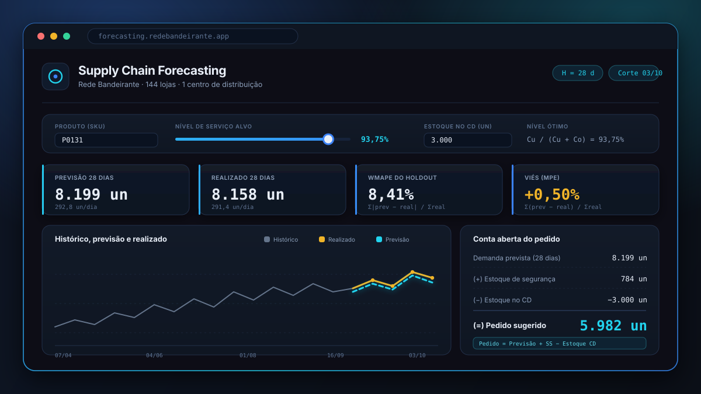

<div align="center">

# Supply Chain Forecasting

**Sistema de previsão de demanda e sugestão de pedido para centro de distribuição no varejo alimentar**

[](https://www.python.org/)
[](https://github.com/astral-sh/uv)
[](https://www.statsmodels.org/)
[](https://www.chartjs.org/)
[](https://flaviohenriquehb777.github.io/Supply-Chain-Forecasting/)
[](LICENSE.md)

<a href="https://flaviohenriquehb777.github.io/Supply-Chain-Forecasting/" target="_blank">
  
</a>

<p>
  <a href="https://flaviohenriquehb777.github.io/Supply-Chain-Forecasting/"><strong>Abrir aplicação</strong></a>
</p>

</div>

---

## Sumário

- [Visão Geral do Modelo](#visão-geral-do-modelo)
- [Objetivos da Análise](#objetivos-da-análise)
- [Estrutura do Modelo](#estrutura-do-modelo)
- [Bases de Dados](#bases-de-dados)
- [Metodologia de Análise · CRISP-DM 6 fases](#metodologia-de-análise--crisp-dm-6-fases)
- [Resultados Chave e Apresentação](#resultados-chave-e-apresentação)
- [Tecnologias Utilizadas](#tecnologias-utilizadas)
- [Instalação e Uso](#instalação-e-uso)
- [Publicação no GitHub Pages](#publicação-no-github-pages)
- [Licença (MIT)](#licença-mit)
- [Contato](#contato)

---

## Visão Geral do Modelo

Este projeto transforma um problema clássico de abastecimento em uma política de decisão explicável para o comprador do centro de distribuição. O contexto é o da Rede Bandeirante, que abastece **144 lojas** a partir de **1 CD** e precisa decidir, a cada ciclo, **quanto comprar por SKU**.

O ponto central do trabalho é que a previsão, sozinha, não resolve o problema. O que vai para a operação é uma conta de negócio:

```text
Pedido = Previsão de demanda + Estoque de segurança - Estoque disponível no CD
```

Para isso, o projeto combina:

- previsão de demanda com modelos de séries temporais;
- avaliação com integridade temporal;
- cálculo de estoque de segurança por distribuição empírica dos erros;
- simulação de custo total de decisão, considerando falta e sobra;
- uma aplicação web estática, em tema dark, pronta para GitHub Pages.

Em vez de entregar apenas um número, a aplicação mostra a **conta aberta do pedido**, para que o comprador saiba de onde saiu cada parcela da recomendação.

---

## Objetivos da Análise

Os objetivos foram construídos para responder às perguntas de negócio do case e aos critérios definidos pela diretoria:

1. Determinar o **horizonte correto de previsão** e o **nível adequado de agregação**.
2. Validar a qualidade das bases e interpretar corretamente o que cada coluna mede.
3. Construir um baseline fiel ao processo atual e compará-lo com modelos mais robustos.
4. Avaliar os modelos de forma que o desempenho prometido se sustente ao longo do ano.
5. Traduzir previsão em **decisão de compra**, com explicabilidade operacional.
6. Reduzir o **custo total em reais**, que é o critério decisivo do projeto.

Em termos práticos, a meta não é apenas prever melhor. A meta é **comprar melhor**.

---

## Estrutura do Modelo

O fluxo lógico do modelo segue a decisão operacional real do comprador:

1. **Escolha do grão de modelagem**: produto x dia, consolidado na rede.
2. **Previsão da demanda de 28 dias**:
   - baseline: média das últimas 4 semanas;
   - modelos comparados: naive sazonal, Holt-Winters, SARIMA e SARIMAX com promoção.
3. **Estimativa do estoque de segurança**:
   - quantil empírico dos erros observados no backtest;
   - nível de serviço ótimo definido pela razão de custos `Cu / (Cu + Co)`.
4. **Política de pedido**:
   - soma da demanda prevista com o estoque de segurança;
   - desconto do estoque disponível no CD.
5. **Entrega operacional**:
   - aplicação estática em `docs/`;
   - interface com conta aberta, gráficos e ajuste em tempo real do estoque do CD.

### Política implementada

```text
Demanda prevista (28 dias)
+ Estoque de segurança
- Estoque disponível no CD
= Pedido sugerido
```

### Modelo vencedor no caso

O modelo que melhor equilibrou precisão e custo total foi o **SARIMAX com promoção**, usando:

- ordem: `(2,1,2)`
- sazonalidade semanal: `(1,1,1,7)`
- variável exógena: `pct_lojas_promo`
- horizonte: `H = 28`
- SEED global: `42`

---

## Bases de Dados

O projeto foi construído sobre duas bases fornecidas no case:

| Base | Granularidade | Linhas | Colunas | Período | Papel no projeto |
|---|---|---:|---:|---|---|
| `data/raw/demanda.csv` | Produto x Dia (rede) | 30.849 | 7 | 02/01/2017 a 31/10/2019 | Base principal de modelagem |
| `data/raw/demanda_por_loja.csv` | Produto x Loja x Dia | 130.843 | 7 | Mesmo período | Base de apoio para comparar loja vs rede |

### Leitura crítica dos dados

- `unidades` registra **venda observada**, não demanda latente. Em dia de ruptura, a venda fica truncada.
- `estoque_total` representa o **estoque somado nas lojas ao fim do dia**, e não o estoque do CD.
- `pct_lojas_promo` foi tratada como exógena futura conhecida, porque o calendário promocional é fechado com **6 a 8 semanas de antecedência**.
- A comparação loja vs rede mostrou que a série agregada é muito mais estável e adequada para previsão.

### Regra de escopo adotada

Três produtos foram removidos do painel por forte evidência de descontinuação:

- `P0438`
- `P0051`
- `P0079`

---

## Metodologia de Análise · CRISP-DM 6 fases

O projeto foi estruturado integralmente em **CRISP-DM**, com notebooks limpos e notebooks executados.

### Fase 1 — Entendimento do Negócio

- definição do horizonte de previsão;
- definição dos critérios de sucesso;
- formalização dos custos de falta e sobra;
- enquadramento do problema como decisão de compra, não apenas previsão.

### Fase 2 — Entendimento dos Dados

- leitura exploratória das bases;
- investigação do significado real das colunas;
- comparação entre granularidade por loja e agregada;
- validação de sazonalidade semanal;
- análise de efeito promocional;
- triagem de itens fora de escopo.

### Fase 3 — Preparação dos Dados

- exclusão de produtos descontinuados;
- separação temporal estrita entre treino e teste;
- regra de integridade temporal para features;
- tratamento de lacunas e padronização das séries.

### Fase 4 — Modelagem

- construção da infraestrutura de avaliação;
- benchmark contra o processo atual;
- modelagem com naive sazonal, média móvel 28d, Holt-Winters, SARIMA e SARIMAX;
- consolidação visual dos resultados.

### Fase 5 — Avaliação

- backtest de **12 origens móveis** espaçadas de 14 dias;
- comparação por WMAPE, viés e custo total;
- cálculo de estoque de segurança empírico;
- decisão do modelo vencedor com base em impacto econômico.

### Fase 6 — Implantação

- exportação dos resultados para frontend estático;
- criação de aplicação em `docs/` para GitHub Pages;
- conta aberta do pedido;
- ajuste dinâmico do estoque do CD e do nível de serviço;
- tema dark e entrega pronta para uso.

### Organização dos notebooks

| Pasta | Objetivo |
|---|---|
| `notebooks/clean/` | Versões finais sem outputs, adequadas para versionamento |
| `notebooks/executed/` | Versões com execução completa e evidências |

---

## Resultados Chave e Apresentação

### Principais respostas do projeto

- **Horizonte correto**: 28 dias (`14 dias de lead time + 14 dias de ciclo de revisão`).
- **Grão correto**: produto x dia, consolidado na rede.
- **Nível de serviço ótimo**: **93,75%**.
- **Modelo vencedor**: **SARIMAX + promoção**.
- **Aplicação final**: estática, explicável e pronta para GitHub Pages.

### Resultados quantitativos do produto foco `P0131`

| Indicador | Resultado |
|---|---:|
| Preço médio | R$ 2,5870 |
| Custo de faltar 1 unidade | R$ 0,7761 |
| Custo de sobrar 1 unidade | R$ 0,0517 |
| Razão custo de falta / sobra | 15:1 |
| Nível de serviço ótimo | 93,75% |
| Estoque de segurança do SARIMAX | 783,6 un |
| Estoque de segurança do processo atual | 2.111,9 un |
| Custo por período do SARIMAX | R$ 107,04 |
| Custo por período do processo atual | R$ 147,11 |
| Redução de custo | **27,2%** |
| Economia anual estimada | **R$ 520,84** |

### Backtest de origens móveis

| Modelo | WMAPE médio | Viés global |
|---|---:|---:|
| Holt-Winters | 15,36% | +1,85% |
| SARIMAX + promoção | 15,39% | +6,40% |
| Naive sazonal | 16,15% | +0,58% |
| SARIMA | 18,18% | +7,44% |
| Média móvel 28d (processo atual) | 22,05% | +6,12% |

### Conta aberta do pedido no cenário de teste

| Componente | Valor |
|---|---:|
| Demanda prevista (28 dias) | 8.198,5 un |
| Estoque de segurança | 783,6 un |
| Estoque disponível no CD | 3.000,0 un |
| **Pedido sugerido** | **5.982,1 un** |

### Evidências visuais disponíveis

- `reports/figures/serie_comparativa_P0131_loja_vs_rede.png`
- `reports/figures/decomposicao_stl_P0131_p7.png`
- `reports/figures/P0131_sarimax_promo_vs_sarima_vs_holt.png`
- `reports/figures/fase5_backtest_WMAPE_por_origem_P0131.png`
- `reports/figures/fase5_custo_estoque_seguranca_por_modelo.png`
- `reports/figures/fase6_conta_aberta_pedido_P0131.png`
- `reports/Perguntas_Case.docx`

### Apresentação do resultado final

O resultado final do projeto foi organizado em três camadas complementares:

1. **Camada analítica**: notebooks e scripts por fase do CRISP-DM.
2. **Camada executiva**: documento de respostas do case para público não técnico.
3. **Camada operacional**: aplicação web que mostra a recomendação de pedido de forma transparente.

---

## Tecnologias Utilizadas

### Modelagem e análise

- Python 3.12
- Pandas
- NumPy
- Statsmodels
- Matplotlib
- Seaborn

### Ambiente e organização

- UV
- Jupyter Notebook
- Git
- GitHub

### Aplicação e deploy

- HTML5
- CSS3
- JavaScript
- Chart.js
- GitHub Pages

---

## Instalação e Uso

### 1. Clonar o repositório

```bash
git clone https://github.com/flaviohenriquehb777/Supply-Chain-Forecasting.git
cd Supply-Chain-Forecasting
```

### 2. Criar o ambiente e instalar dependências

```bash
uv sync
```

### 3. Executar scripts analíticos

Exemplos:

```bash
uv run python scripts/fase5_simulacao_custo_total.py
uv run python scripts/fase6_export_app_data.py
uv run python scripts/fase6_politica_pedido.py
```

### 4. Rodar a aplicação localmente

```bash
uv run python -m http.server 8000 --directory docs
```

Depois abra:

```text
http://localhost:8000/
```

### 5. Estrutura principal do repositório

```text
Supply-Chain-Forecasting/
├── case/
├── data/
├── docs/
├── notebooks/
├── reports/
├── scripts/
├── src/
├── LICENSE.md
├── README.md
├── pyproject.toml
├── requirements.txt
└── uv.lock
```

---

## Publicação no GitHub Pages

A aplicação foi preparada para rodar como site estático a partir da pasta `docs/`.

### Estrutura de publicação

- `docs/index.html`
- `docs/css/style.css`
- `docs/js/app.js`
- `docs/data/forecasts.js`
- `docs/assets/logo.png`
- `docs/assets/thumbnail.svg`
- `docs/.nojekyll`

### URL esperada de produção

```text
https://flaviohenriquehb777.github.io/Supply-Chain-Forecasting/
```

### O que a aplicação entrega

- seleção de SKU;
- visualização do histórico, previsão e realizado;
- ajuste do nível de serviço;
- ajuste do estoque do CD;
- recalculo instantâneo do pedido sugerido;
- diagnóstico da decisão em linguagem de negócio.

---

## Licença (MIT)

Este projeto está distribuído sob a licença MIT.

Consulte o arquivo [LICENSE.md](LICENSE.md) para os termos completos.

---

## Contato

<div align="center">

<table>
  <tr>
    <th>Canal</th>
    <th>Link / Contato</th>
  </tr>
  <tr>
    <td>Nome</td>
    <td>Flávio Henrique Barbosa</td>
  </tr>
  <tr>
    <td>LinkedIn</td>
    <td><a href="https://www.linkedin.com/in/flávio-henrique-barbosa-38465938">linkedin.com/in/flávio-henrique-barbosa-38465938</a></td>
  </tr>
  <tr>
    <td>Email</td>
    <td><a href="mailto:flaviohenriquehb777@outlook.com">flaviohenriquehb777@outlook.com</a></td>
  </tr>
</table>

</div>
